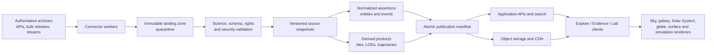

# Platform Blueprint

**Status:** recommended architecture for benchmarking; not yet locked
**Goal:** support evidence-aware exploration from cosmological context to local terrain without making one database, renderer, or coordinate system responsible for every scale.

## Architecture in one sentence

Cosmography is a versioned scientific knowledge and content platform whose clients move through several coordinated render domains while a common evidence layer supplies identities, time, geometry, provenance, uncertainty, and rights.



## Product surfaces

### Explore

The default public experience: fly-to search, continuous-feeling zoom, time controls, layers, mission replay, guided tours, bookmarks, comparison, accessibility, and an intelligible narrative.

### Evidence

The same scene with inspectable source products, observation details, error/coverage, coordinate/time choices, processing lineage, rights, citations, version history, competing assertions, and download/deep links.

### Lab

Advanced controls for frames, observer modes, epochs, corrections, filters, raw/calibrated products, visualization parameters, queries, reproducible scene manifests, and export. Research capability grows here without burdening the default interface.

## System boundaries

### 1. Source registry and governance

The registry is executable policy, not a documentation-only list. It controls:

- endpoints, credentials, quotas, concurrency, contact information, and source health;
- release/cadence detection;
- data and per-asset rights;
- allowed cache, mirror, derivative, commercial, and offline behavior;
- schema/frame/time/uncertainty expectations;
- connector version and fixtures;
- freshness objectives and kill switches;
- required review before publication.

### 2. Connector and ingestion plane

Reusable adapter families handle SPICE, PDS4, IVOA, planetary geospatial data, time series, and event streams. Source-specific adapters can share transport, retries, checkpointing, raw capture, metrics, secrets, and validation.

An ingestion run is idempotent and replayable:

1. Detect a source release, delta, query window, or event.
2. Capture response/request metadata and raw bytes in quarantine.
3. Verify checksums/signatures where supplied; calculate local hashes.
4. Scan untrusted archives, documents, models, and media.
5. Parse without modifying the raw object.
6. Validate schema, units, frames, coverage, uncertainty, and rights.
7. Normalize assertions while retaining source fields.
8. Create render/search derivatives with a recorded processing activity.
9. Run numeric, visual, and provenance tests.
10. Promote through an atomic signed manifest or keep quarantined.

No connector writes directly into the public namespace.

### 3. Scientific identity and assertion layer

Cosmography owns stable internal identifiers but not the source facts. Authority identifiers remain first-class crosswalks: NAIF IDs, PDS LIDVIDs, Gaia source IDs plus release, MPC designations, NED/SIMBAD identifiers, DOI, bibcode, NORAD IDs, mission/product identifiers, and agency names.

Entity resolution is scored and reviewable. Two records are never merged only because names are similar. The cross-match stores its method, confidence, supporting fields, review, and reversibility.

Facts are assertions. Multiple published distances, classifications, event dates, or historical interpretations can coexist. A preferred assertion has a documented selection rule and time/version; it does not erase alternatives.

### 4. Geometry, frame, and time service

One service exposes domain-aware transformations and reproducible geometry:

- SPICE kernel-set management and coverage;
- Horizons verification and explicitly sourced query states for approved objects/time spans;
- IAU SOFA and IERS Earth-orientation conversions;
- catalog epoch propagation with covariance;
- planetary CRS and body-model definitions;
- geometric versus observer/apparent state;
- light-time, aberration, time-scale, and unit metadata;
- transform chains used by clients and pipelines.

Responses carry input IDs, observer/target, time, time scale, frame, center, corrections, coverage, source release/kernel set, uncertainty/freshness, service version, and cache identity. Missing SPICE coverage fails explicitly unless a caller requests an approved Horizons-sourced state; that transition changes the source/quality label and is never a transparent fallback.

### 5. Derivative/tiling plane

Scientific master products remain intact. Viewing formats are derived:

- FITS/WCS to HiPS and browser texture pyramids;
- catalog tables to HEALPix/MOC-partitioned Parquet and point LODs;
- planetary GeoTIFF/DEM to COG and body-specific terrain tiles;
- DSK/photogrammetry/CAD to glTF or body-fixed 3D Tiles where valid;
- SPICE states to bounded trajectory caches, never unversioned polylines;
- images/video/audio to web derivatives without removing provenance/credit;
- simulation outputs to declared LOD/volume products.

Each output hash resolves to its inputs, code commit/container, parameters, review, rights inheritance, and validation report.

### 6. Search and discovery

Search unifies names but never hides ambiguity. It supports:

- exact authority IDs and designations;
- names, aliases, multilingual labels, historic names, and misspellings;
- coordinates, footprints, time, mission, organization, instrument, wavelength, evidence type, and quality filters;
- intent such as object, surface place, mission, event, observation, facility, paper, or tour;
- cross-match confidence and disambiguation;
- “nearby” defined for the current domain and epoch.

Search returns a navigation target plus its identity/provenance summary, not just a camera coordinate.

### 7. Narrative and timeline service

Events remain separate from raw measurements. Editorial stories cite observations, products, papers, images, missions, people, and places. The model distinguishes event time, observation time, publication time, source validity, ingestion time, and narrative revision.

Mission replay manifests pin scientific and editorial inputs. A tour can be rerun later exactly or intentionally upgraded to a new release.

## Storage plan

### Immutable object storage

Use S3-compatible storage for raw downloads, original headers/labels, terms snapshots, checksums, stream packets, source manifests, and large derivatives. Enable versioning, retention policies, lifecycle tiers, malware scanning, and object-level metadata. Large source archives and tiles do not belong in Git.

### PostgreSQL/PostGIS

Use for canonical entities, authority IDs, assertions, units, frames, datasets, observations, missions, events, rights, attribution, editorial workflows, publication manifests, reviews, community proposals, and suitable spatial footprints.

Start relational. PostgreSQL can represent graph edges and provenance traversal at the initial scale. Add a graph database only when measured query patterns cannot meet their latency/complexity targets.

### Columnar catalog/time-series layer

Use Parquet/Arrow with partitions by source release, table, time window, and HEALPix/MOC cell. Query through DuckDB for development and a distributed engine/lakehouse only when volume or concurrency proves the need. Preserve FITS/VOTable/CDF as scientific source formats; columnar data is a normalized access product.

### Search index

Use OpenSearch or an equivalent index for names, aliases, text, facets, suggestions, and filtered discovery. The relational store remains authoritative. Index documents carry publication-manifest IDs so a release can be atomically activated or rolled back.

### Cache and queues

Use Redis only for bounded ephemeral cache/rate coordination if needed, and a durable queue/stream for ingestion events. Scientific truth never exists only in a cache or queue.

### CDN

Serve immutable hash-addressed tiles/assets through a CDN. Credits, labels, and manifest links travel with the layer. Signed offline packs use the same content identities.

## Multi-scale rendering strategy

The client presents a continuous journey while swapping mathematical/rendering domains:

1. Celestial sphere and survey imagery.
2. Cosmological light cone and catalog/simulation layers.
3. Galactic and local-star catalog space.
4. Solar-System barycentric/body-centered dynamics.
5. Body globe and terrain.
6. Local surface/instrument scenes.
7. Specialized models such as black-hole ray tracing.

Each renderer consumes a shared scene contract but remains honest about its domain. A transition gateway resolves the destination, visible parent/child context, target frame/origin, LOD, evidence state, and camera handoff.

### Precision

Raw values, source precision, and uncertainty remain preserved. Scientific computation uses domain-appropriate numerical representations—typically Float64, with split/integer time and higher precision where required. Clients use camera-relative/high-low split coordinates, hierarchical origins, and explicit domain transitions. Physical sizes and positions stay separate from visual scaling. WebGL2 is the baseline until WebGPU compatibility and numerical behavior meet a published benchmark.

### Candidate composition

- **CesiumJS/3D Tiles:** browser base for globes, terrain, hierarchical LOD, time-dynamic objects, and Earth/body scenes; requires careful non-Earth adaptation.
- **Custom Three.js/WebGL/WebGPU modules:** deep-space point/volume and special scientific renderers, governed by the common coordinate service.
- **Direct HiPS/WCS renderer or compatible WWT component:** progressive sky imagery and catalog overlays.
- **OpenSpace:** benchmark and potential engine for native, dome, and museum installations; already demonstrates SPICE, Gaia, globes, and multi-scale navigation.

Aladin Lite, Stellarium, and GYOTO are valuable validators/references but have GPL implications if linked into a proprietary distribution. License isolation must be decided before integration.

No engine decision is final until the benchmark proves:

- scale transition quality and precision;
- non-Earth coordinate correctness;
- Web accessibility and input support;
- deterministic time/geometry replay;
- terrain/sky/point-catalog streaming;
- large-catalog memory and frame-time behavior;
- evidence overlay and attribution support;
- offline pack behavior;
- museum/dome path if required;
- license and operating cost.

## Proposed service/API boundaries

- **Registry API:** sources, datasets, rights, releases, connector health.
- **Knowledge API:** entities, authority IDs, assertions, relationships, events, organizations, places.
- **Observation API:** observations, footprints, bands, instruments, source products, DataLink-style access.
- **Geometry API:** state vectors, transforms, frames, time conversions, light-time modes, coverage.
- **Layer API:** render manifests, LOD/tiles, labels, credits, evidence state, validity.
- **Search API:** names/IDs/full text/facets/spatial and temporal discovery.
- **Timeline/Tour API:** versioned events, scenes, narration, citations, replay manifests.
- **Contribution API:** proposed assertions/annotations/translations/assets, review, moderation, audit.

Public science interfaces should use IVOA TAP/ADQL/DataLink patterns where they fit instead of inventing incompatible query semantics.

## Publication manifest

Every release contains:

- manifest and schema version;
- source dataset/product versions and stable IDs;
- input/output hashes and byte sizes;
- connector, transformer, container, and code versions;
- frame/time/unit definitions and coverage;
- uncertainty and quality-field mapping;
- representation labels and display transformations;
- exact rights, credits, required placement, and terms snapshot hashes;
- validator/test results and reviewers;
- publication/expiry/supersession state;
- rollback target and compatibility requirements.

Publication uses an explicit activation protocol:

1. Assign an immutable release ID and build database rows, object keys, indexes, and CDN assets in that release namespace.
2. Wait at a readiness barrier until every required component and validator reports the same release ID ready.
3. Canonically serialize and sign the manifest with a managed signing key; record key ID, algorithm, validity, rotation, revocation, and verification policy.
4. Atomically switch one authoritative active-release pointer only after readiness and signature verification.
5. Make clients resolve and cache the release ID, never a mixture of mutable “latest” component paths.
6. Roll back by switching the pointer to a compatible prior release; do not delete immutable data during incident recovery.

Signing keys belong in a managed key service/HSM with separated release authority, audit logs, rotation, and an offline recovery path. A Stage 0 ADR will define canonical serialization, trust roots, activation transaction boundaries, client verification, and disaster recovery.

## Operations and observability

Monitor per connector and release:

- upstream reachability and schema/version change;
- last successful source check, retrieval, validation, and publication;
- API quota/concurrency and response status;
- stream offset, source/ingest lag, revisions and retractions;
- record/byte counts, coverage, missing/null/quality changes;
- rights/terms age and review deadline;
- derivative job duration/failures and storage/egress cost;
- public manifest and client version adoption;
- kill-switch and rollback readiness.

Freshness indicators in the product come from these metrics, not marketing text.

## Security and rights controls

- Store credentials in a secret manager; never in Git, manifests, logs, or browser bundles.
- Sandbox parsers for FITS/HDF5/CDF, archives, 3D models, documents, and media.
- Scan uploads/downloads and constrain decompression, memory, and geometry complexity.
- Generate an SBOM; pin/scan dependencies and containers; sign releases and offline packs.
- Separate proprietary/embargoed data namespaces with policy enforcement and audit logs.
- Fail publication when rights, exact credit, or source identity is incomplete.
- Maintain takedown, correction, embargo-expiry, and upstream-license-change workflows.
- Keep community proposals quarantined until schema, evidence, duplicate, security, and rights checks plus human review pass.
- Define the account/authorization model before collecting user data. Apply data minimization, purpose/retention limits, export/deletion, consent and age policy, privacy/security review, and role/audit controls.
- Before serving children or collecting student data, determine COPPA and school-data obligations plus applicable GDPR/CCPA requirements; provide parent/guardian and institution flows where legally required.
- Provide abuse reporting, moderation safety tools, escalation, appeals, block/mute controls, and privacy-preserving defaults for community features.

## Development topology

A practical initial monorepo can contain:

```text
apps/
  web/                 Explore, Evidence, and Lab client
  admin/               curation, rights, review, source health
services/
  api/                 knowledge/search/layer facade
  geometry/            SPICE, SOFA/IERS, transforms and coverage
workers/
  connectors/          source adapters and fixtures
  derivatives/         tiling, LOD, media and trajectory builds
packages/
  scientific-model/    shared schemas, units, frames and labels
  scene-contract/      renderer-neutral scenes/manifests
  ui/                  accessible design system
data/
  registry/            source definitions without secrets
docs/
  research/ architecture/ decisions/ validation/
infra/
  local/ deploy/ observability/
```

Suggested starting technologies are TypeScript for client/shared contracts, Python for scientific adapters and geometry workflows, PostgreSQL/PostGIS, S3-compatible object storage, Parquet/Arrow, and OpenSearch. A Rust or C++ service is justified only after profiling reveals a numerical or throughput bottleneck.

## Architecture acceptance gate

Do not scale ingestion until a thin vertical slice proves:

- one source passport and rights ledger end to end;
- immutable capture and replayable connector;
- normalized assertions with competing values;
- SPICE geometry with frame/time/correction disclosure;
- one derived render layer with full lineage;
- multi-domain camera handoff;
- search to a versioned navigation target;
- evidence panel and exact credits;
- automated numeric/provenance tests;
- atomic publication and rollback;
- measured cost and performance.

Voyager 1 is the recommended architecture slice because it exercises most of these boundaries before large terrain/catalog ingestion begins.
